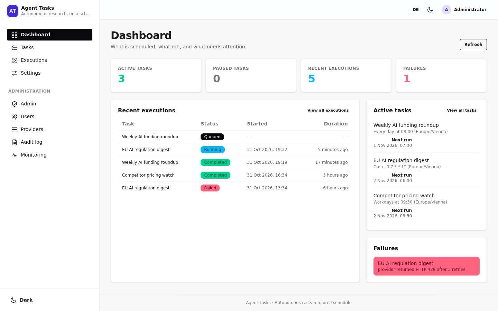
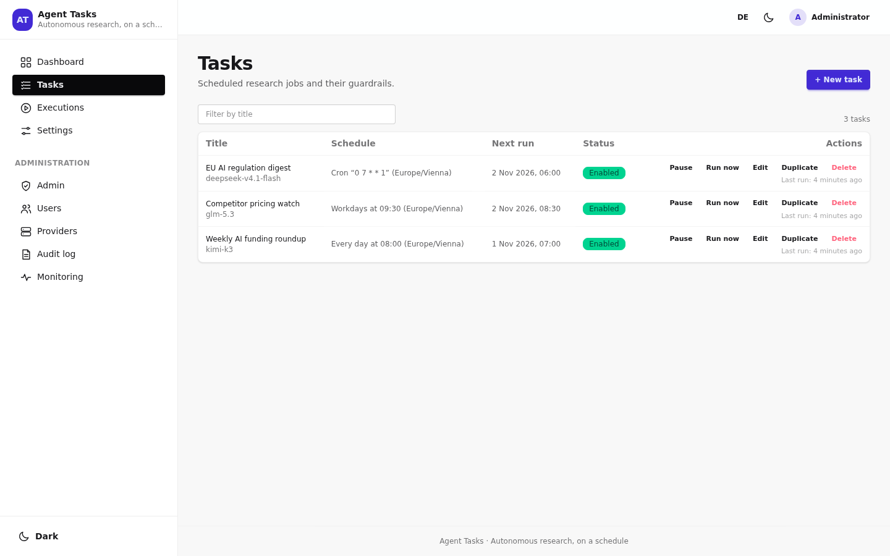
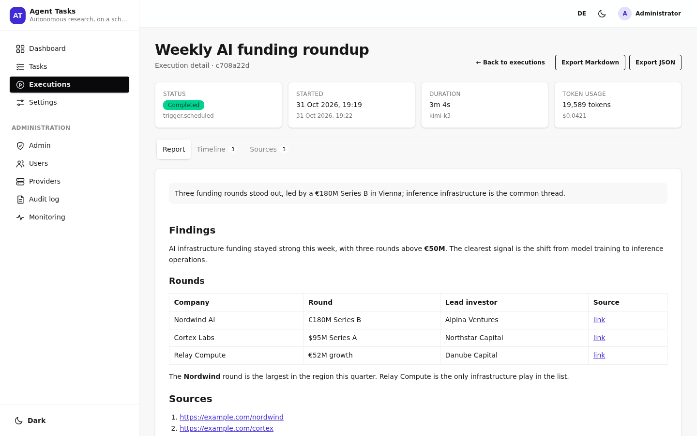
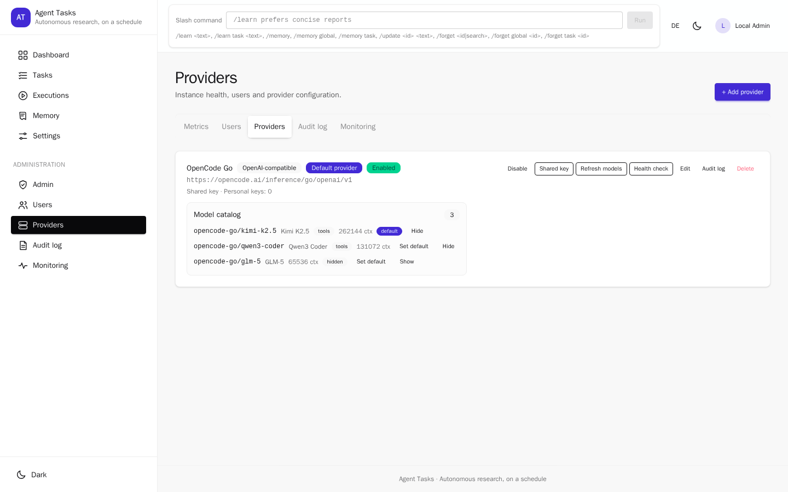
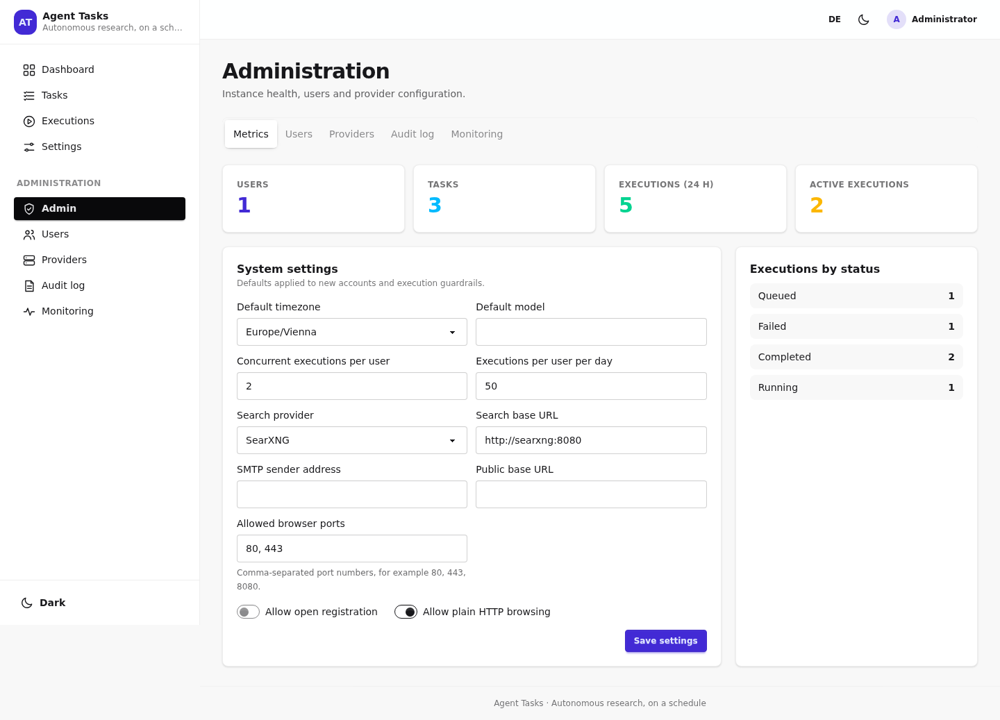

# Agent Tasks

**A self-hosted research team that runs on your schedule.** Turn a question into
a recurring job: the agent searches the web, opens pages, keeps the sources,
writes a sourced report and e-mails you when it is done. Everything runs on your
own server, with your own provider key.



> **Status:** early but working. Every claim in this README is backed by a test or
> a command you can rerun — see [`docs/VERIFICATION_REPORT.md`](docs/VERIFICATION_REPORT.md)
> for the evidence and open gates. The OpenAI-compatible adapter is tested against
> deterministic local mocks; no OpenCode Go account was available in the
> verification environment, so real-account behaviour is **NOT VERIFIED**
> ([details](docs/architecture/providers.md#verification-status)).

## A quick tour

### Schedule briefings in your timezone

Cron or presets (once, daily, weekdays, weekly, monthly, custom), IANA timezones
and correct DST handling. Pause, run now, duplicate or retry from the task page.



### Read sourced reports, not just answers

The agent records every page it opened, labels uncertainty and persists a
Markdown report. The execution view shows status, duration, token usage, timeline
and sources.



### Give it a memory

Each user has an editable global memory for preferences and instructions; each task has its own memory for findings, decisions, progress and recommendations. Both survive restarts, are injected into later runs and can be inspected, edited or forgotten from the UI or with `/learn`, `/memory`, `/update` and `/forget`. See [`docs/memory.md`](docs/memory.md).

### Let the agent compose the e-mail

With **Email me** enabled, the agent adds e-mail blocks through a compact
[e-mail DSL](docs/email-dsl.md). The server validates the blocks and renders
table-based, inline-styled HTML — including an image beside text.

### Admin without the guesswork

Providers, users, invitations, limits, the registration toggle and the audit log
live in one admin area.





## What you can do

- **Recurring research briefings** with presets or cron, per-task timezone
  (Europe/Vienna tested), pause/resume, manual runs and retries.
- **Real web research** through SearXNG and Playwright: multiple pages, extracted
  text, persisted sources and honest uncertainty.
- **Bring your own model**: OpenCode Go, OpenAI or any OpenAI-compatible gateway,
  with encrypted provider keys and optional model variants (`model#high`).
- **Completion e-mails** composed by the agent (image-beside-text blocks and
  more), rendered email-safe and spam-checked in CI.
- **Multi-user from day one**: invitations, ADMIN/USER roles, TOTP MFA,
  owner-scoped tasks, reports, logs and credentials.
- **Durable, editable memory**: global user memory and per-task memory with
  automatic task learning, recommendation tracking, versioned edits, search,
  export and permanent, tombstoned deletion. Slash commands work across sessions.
- **A hardened browser**: non-root, read-only, no Docker socket, egress proxy
  with DNS-rebinding protection, Chromium sandbox enabled by default.

Full walkthrough: [`docs/USER_GUIDE.md`](docs/USER_GUIDE.md).
Screenshots are generated with [`scripts/capture-readme-screenshots.mjs`](scripts/capture-readme-screenshots.mjs)
and committed under [`docs/images/`](docs/images/).

## Architecture in one picture

```
 Browser ──► Caddy (TLS, global) ──► api (Fastify + built SPA)
                                      │  Better Auth sessions, RBAC, audit
                                      ▼
                                 PostgreSQL ◄── worker (pg-boss)
                                      ▲              │ agent loop
                                      │              ▼
                                 executions     browser-runner ──► enforcing proxy ──► Internet
                                                                     │
                                                                blocked: loopback,
                                                                RFC1918, link-local,
                                                                metadata, ULA, …
```

Details: [`docs/architecture/overview.md`](docs/architecture/overview.md).

## Quick start (Docker Compose)

The ready-made entrypoints for **production, local and E2E** live in
[`deployment/README.md`](deployment/README.md). Each stack has its own compose
project name, host ports, networks, volumes and `com.agent-tasks.stack` label, so
a local stack and the E2E stack can run side by side. The commands below use the
root `compose.yaml` directly.

```bash
git clone https://github.com/all-the-rest/agent-tasks.git
cd agent-tasks
cp .env.example .env
POSTGRES_PASSWORD=$(openssl rand -hex 24)
AUTH_SECRET=$(openssl rand -hex 32)
SECRETS_ENCRYPTION_KEY=$(openssl rand -base64 32)
SETUP_TOKEN=$(openssl rand -hex 32)
RUNNER_TOKEN=$(openssl rand -base64 24)
sed -i \
  -e "s|^POSTGRES_PASSWORD=.*|POSTGRES_PASSWORD=${POSTGRES_PASSWORD}|" \
  -e "s|^AUTH_SECRET=.*|AUTH_SECRET=${AUTH_SECRET}|" \
  -e "s|^SECRETS_ENCRYPTION_KEY=.*|SECRETS_ENCRYPTION_KEY=${SECRETS_ENCRYPTION_KEY}|" \
  -e "s|^SETUP_TOKEN=.*|SETUP_TOKEN=${SETUP_TOKEN}|" \
  -e "s|^RUNNER_TOKEN=.*|RUNNER_TOKEN=${RUNNER_TOKEN}|" \
  .env
docker compose --profile search up -d --build
grep '^SETUP_TOKEN=' .env
```

The public images are published at
`ghcr.io/all-the-rest/agent-tasks/{api,browser-runner}`. The root
`compose.yaml` builds api, worker and browser-runner from this checkout
(`pull_policy: build`), so start it with `--build` as shown above. The
production file `deployment/compose.production.yaml` has no `build` and pulls
the published images instead.

`sed -i` is GNU syntax; on macOS use `sed -i ''`. The root/local compose
fallbacks are `POSTGRES_PASSWORD=agent`, `PUBLIC_BASE_URL=http://localhost:8080`
and `HTTP_PORT=8080`; the generated `.env` above overrides the secrets. The
production compose file deliberately has no insecure fallbacks and requires those
values. Every variable and its code default is listed in
[`DEPLOYMENT.md`](DEPLOYMENT.md).

Open `http://localhost:8080`, paste the token from the last command on the setup
screen and create the first administrator.

Alternatively set `ADMIN_EMAIL`, `ADMIN_PASSWORD` (at least 12 characters) and
optionally `ADMIN_NAME` in `.env`: the API creates the first administrator on
start and the setup screen is skipped. Both variables must be set together.

For production, use the host-managed workflow in
[`DEPLOYMENT.md`](DEPLOYMENT.md#production-on-the-docker-host-optstacks): create
`/opt/stacks/agent-tasks/.env` from `deployment/env/production.env.example` as
root:root 0600, then run `DEPLOY_HOST=root@docker.example deployment/deploy.sh`.
The preflight validates the effective Compose-interpolated values (never raw
`.env` text), rejects placeholders and insecure defaults, requires the
Caddy/proxy-owned `webnet` to be exactly `172.18.0.0/16` gateway `172.18.0.1`,
and backs up `.env`/the database before reconciling the stack. SSH uses strict
host-key checking against your existing `~/.ssh/known_hosts`. The root `.env.production` is only a local/single-host template, not
the production host environment. The host env sets `ALLOW_REGISTRATION=false` and
seeds an **OpenCode Go** provider from `OPENCODE_GO_*` on first start; the API key
is encrypted at rest. The registration value is only the initial database
setting — an administrator can change it later in **Admin → Settings**.

Then:

1. **Admin → Providers** → kind `openai-compatible`, base URL
   `https://opencode.ai/inference/go/openai/v1` for OpenCode Go (confirm it with your
   account) or your endpoint's API root, save, store the API key as a credential,
   refresh models.
2. **Admin → Users** → invite users (single-use link, valid 7 days).

`--profile search` starts SearXNG; omit it for an install without web search. Its
secret is `server.secret_key` in `docker/searxng/settings.yml`; change it before
exposing the profile. Provider details, headers and error mapping:
[`docs/architecture/providers.md`](docs/architecture/providers.md).

## Development

```bash
pnpm install
cp .env.example .env            # uncomment DATABASE_URL, fill the required secrets
set -a; . ./.env; set +a        # the apps do not read .env themselves
pnpm db:generate && pnpm db:migrate
pnpm dev                        # api :8080, web :5173 (proxy -> api), worker
```

The worker expects a browser runner at `RUNNER_URL` (default
`http://browser-runner:8081`). For local browser tasks, start
`pnpm --filter @agent-tasks/browser-runner dev` on port 8081 and set
`RUNNER_URL=http://127.0.0.1:8081`. Chromium runs with its internal sandbox:
the shipped seccomp profile allows `unshare(CLONE_NEWUSER)` and
`clone(CLONE_NEWUSER|…)`, and the container keeps `CAP_SYS_CHROOT` for the
sandbox's chroot. The host kernel must permit unprivileged user namespaces;
if it does not, the runner refuses to start unless you explicitly set
`RUNNER_CHROMIUM_SANDBOX=false` (logged as `sandbox_disabled`, never for
production). The `PUBLIC_BASE_URL` in `.env.example` targets the compose port;
for the Vite dev server change it to `http://localhost:5173` so reset links
point at the dev UI.

Quality gates:

```bash
pnpm lint
pnpm typecheck
pnpm test:unit
pnpm test:integration           # needs Postgres, see TESTING.md
pnpm build
```

## Providers

| Kind | Notes |
| --- | --- |
| `openai-compatible` | **Primary.** Any endpoint with `/chat/completions`; `/models` is used for discovery, or declare models in `config.models`. Sends an honest `User-Agent`, one stable `x-opencode-session` per execution attempt, streams by default and honours any extra headers you configure. |
| `openai` | Same adapter, no built-in defaults: set `baseUrl` to `https://api.openai.com/v1`. |
| `ollama` | Legacy/development adapter, not deployed in production. Models come from `/api/tags`, tool support from `/api/show`; a model without the `tools` capability is refused. |
| `codex` | Experimental, **disabled by default**. Account-scoped `codex exec` with a per-user `CODEX_HOME` under `CODEX_HOME_ROOT`, no tool calling, no browser cookies. See [`docs/architecture/providers.md`](docs/architecture/providers.md). |

## Security posture

- Public registration is off by default (`ALLOW_REGISTRATION=false` and the
  admin settings toggle); onboarding is invite-only with single-use tokens.
  Enabling it opens the `/register` page and a direct sign-up as `USER`; an
  administrator can switch it off at any time.
- Completion e-mails (task setting "Email me") are composed by the agent in a
  compact [e-mail DSL](docs/email-dsl.md) (`compose_email`): headings,
  paragraphs, images, image-beside-text, buttons and dividers. The server parses
  and validates the DSL and renders email-safe HTML; the model never writes HTML.
- Sessions are revocable; sign-out invalidates the session on the next request.
- TOTP MFA (with backup codes) is available and tested end to end.
- Passwords are hashed by Better Auth; there are no default credentials.
- Provider secrets are AES-256-GCM encrypted at rest and never returned by an API.
- CSRF: Better Auth origin checks plus an explicit origin guard on the app routes.
- SSRF: URL policy in the tool layer **and** an enforcing proxy in the browser
  container, which resolves DNS and pins the checked address.
- Reports render Markdown through `rehype-sanitize`; stored XSS is covered by tests.

Full threat model: [`SECURITY.md`](SECURITY.md).

## Repository layout

```
apps/web              React 19 + Vite + Tailwind 4 + daisyUI
apps/api              Fastify 5 REST API, Better Auth, RBAC, audit log
apps/worker           pg-boss scheduler + agent execution, leases, retries
services/browser-runner  Playwright + enforcing egress proxy
packages/shared       Zod schemas, schedule math, network policy, errors
packages/database     Drizzle schema, SQL migrations
packages/ai-providers OpenAI-compatible, Codex and legacy Ollama adapters, secret box
packages/agent-runtime  Tool definitions, prompt policy, agent loop
packages/browser-tools  Runner client, SearXNG client
packages/mock-openai  Deterministic OpenAI-compatible test endpoint
```

## License

Apache-2.0. See [`LICENSE`](LICENSE).
