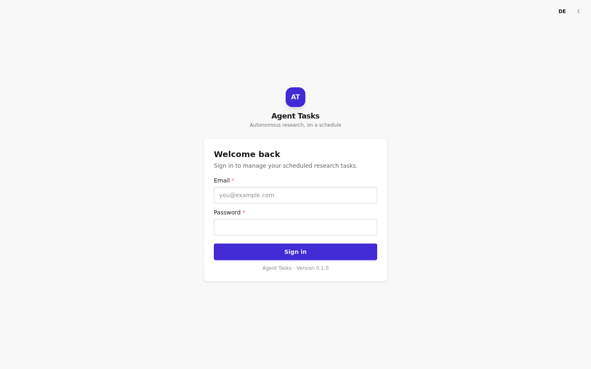
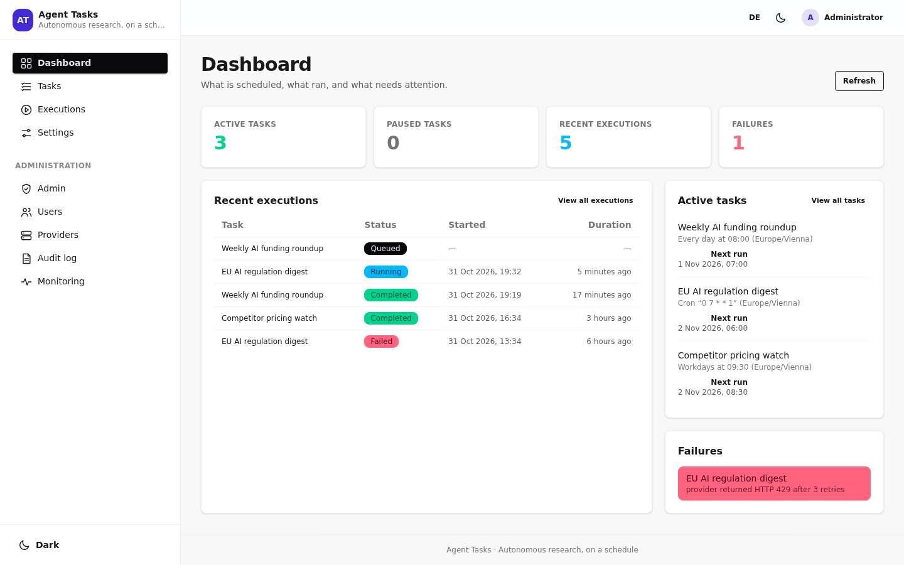
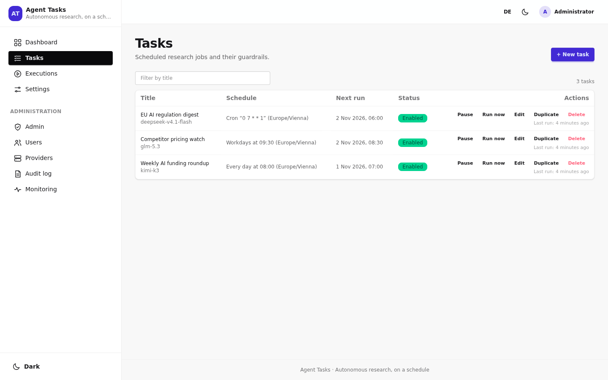
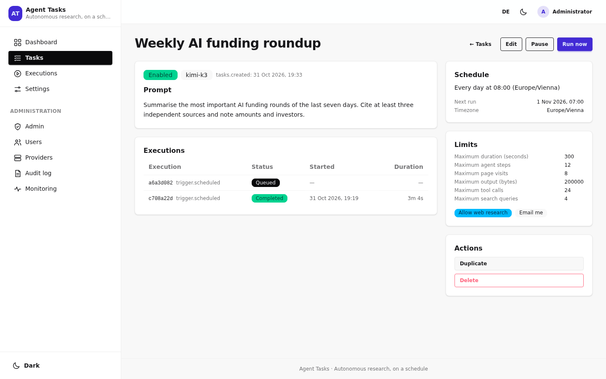
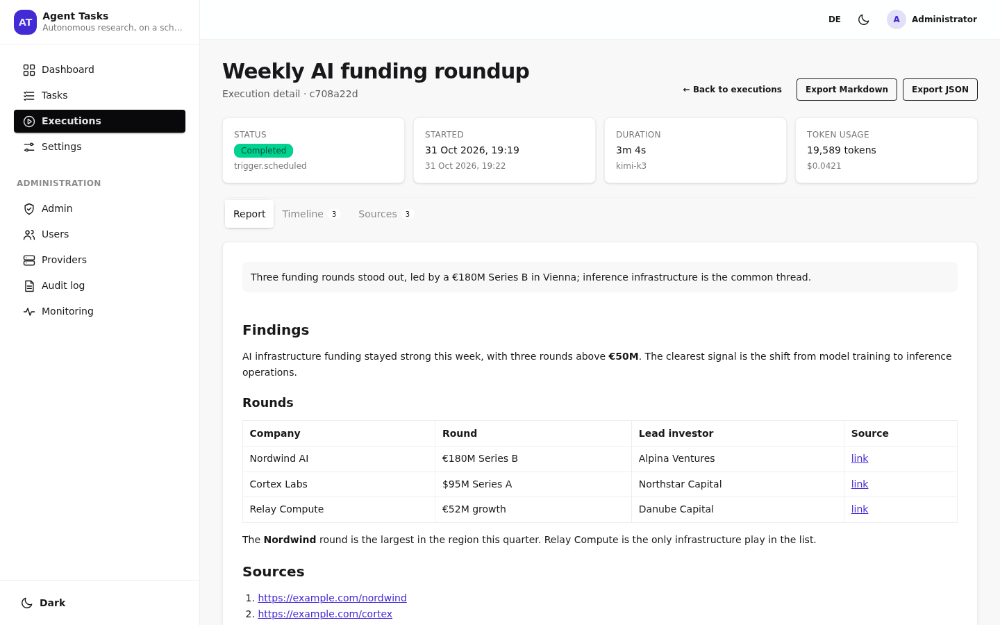
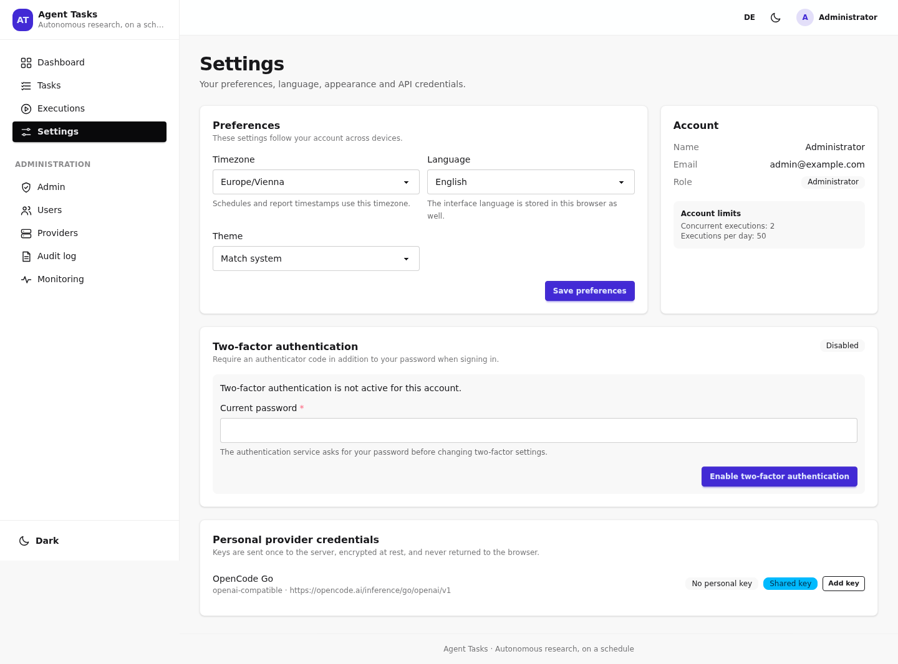
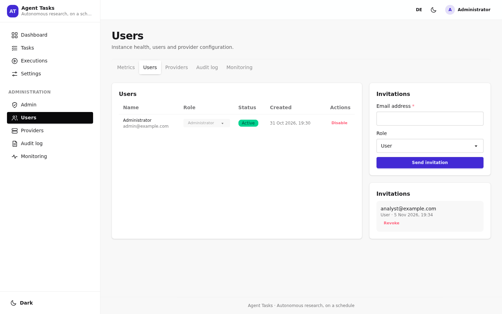
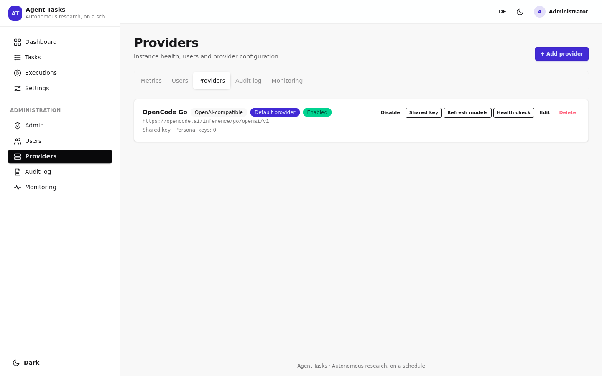
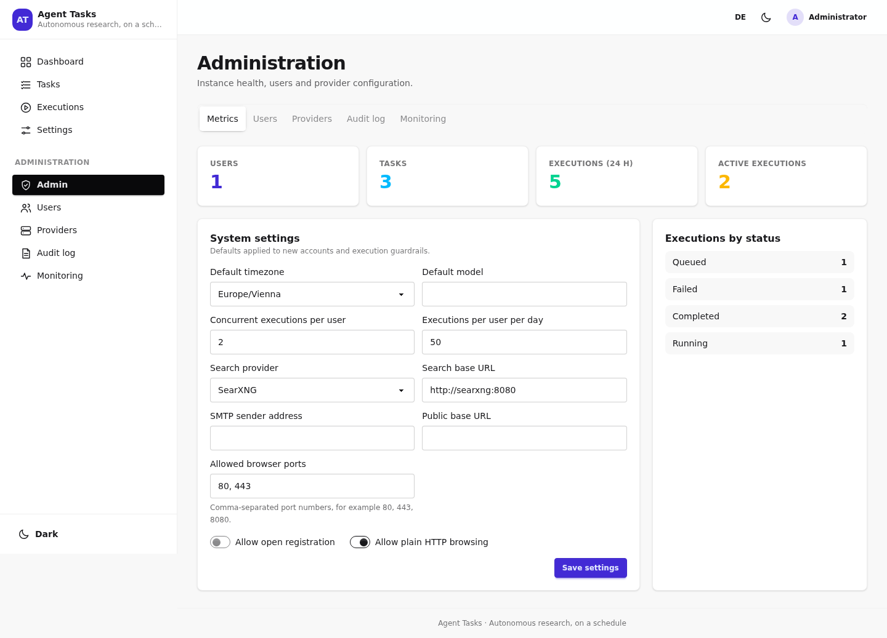
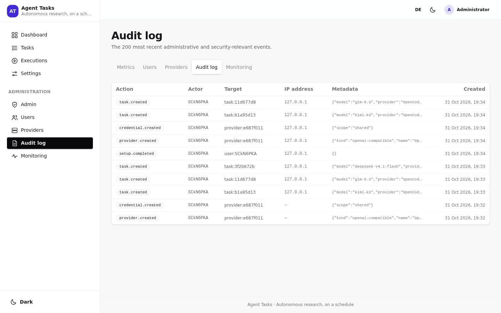

# User guide

Agent Tasks turns a question into a recurring research job. You describe what you
want, choose when it should run, and the agent searches the web, reads pages,
writes a sourced report and (optionally) e-mails you.

All screenshots below are committed under `docs/images/` and can be regenerated
with `node scripts/capture-readme-screenshots.mjs` against a seeded instance.

## Sign in

Your administrator creates the account with an invitation, or the instance is
bootstrapped from `ADMIN_EMAIL`/`ADMIN_PASSWORD` on first start. Open the link in
the invitation e-mail, choose a name and password (at least 12 characters), and
sign in.

## Dashboard

The dashboard shows active and paused tasks, recent executions, failures and the
next run of every active task. **Refresh** reloads the data; **View all** opens
the full lists.

## Tasks

The task list shows the schedule (preset or cron), the next run in the task's
timezone, the model and the last run. From here you can **Pause**, **Run now**,
**Edit**, **Duplicate** or **Delete**.

### Create a task

1. **New task** → choose a title and write the prompt as if briefing a
   researcher: what to find, which sources to prefer, what to compare.
2. Pick the provider and model. Variants are optional: append `#high`, `#low`
   etc. to the model id (see [model variants](architecture/providers.md#model-variants-suffix)).
3. Choose a schedule:
   - **Once** with a date and time,
   - **Daily**, **Weekdays**, **Weekly** or **Monthly** with a local time,
   - **Custom** with a 5-field cron expression.
4. Pick the timezone (for example `Europe/Vienna`). DST gaps and overlaps are
   handled by the scheduler.
5. Adjust the limits if needed: duration, agent steps, page visits, output size,
   tool calls and search queries.
6. Decide whether the agent may browse the web and whether to **Email me** when
   the run finishes.
7. Save. The task is enabled unless you switch it off.

### Task detail

The detail page repeats the prompt and limits and lists every execution. Use
**Run now** for an immediate manual run, **Pause** to stop future schedules and
**Edit** to change the definition. A task can have at most one queued or running
execution at a time.

## Executions and reports

An execution moves through **Queued → Running → Completed** (or **Failed**,
**Timed out**, **Cancelled**). The detail page has three tabs:

- **Report** — the summary, the full Markdown report (tables, lists, links) and
  the uncertainty notes.
- **Timeline** — every tool call with its arguments and result preview.
- **Sources** — every visited URL with its title, retrieval time and confidence.

Export the report as Markdown or JSON. Failed executions can be retried from the
detail page or the executions list.

## E-mail notifications

Set a task to **Email me** and the agent composes a completion e-mail. It can add
an image beside text and other blocks through a compact DSL; the server validates
the blocks and renders email-safe HTML. See [the e-mail DSL](email-dsl.md) for
the syntax and limits.

Delivery needs `SMTP_URL` (and optionally `SMTP_FROM`). Without SMTP the message
is written to the worker log in development.

## Settings

Change your timezone, interface language (English/German) and theme. Enable
two-factor authentication with an authenticator app or backup codes. Personal
provider credentials are encrypted at rest, sent once and never returned by the
API.

## Administration

Administrators see the **Administration** section in the sidebar.

### Users and invitations

Invite an address and choose the role (`USER` or `ADMIN`). Invitations are
single-use and expire after seven days. Disable an account to revoke access; the
last administrator cannot be removed.

The **Allow open registration** setting decides whether `/register` is available.
When it is off, accounts only exist through invitations.

### Providers

Add an OpenAI-compatible endpoint (OpenCode Go, OpenAI or a gateway), store its
shared or per-user key, refresh models and run a health check. The provider can
also be seeded at start from `OPENCODE_GO_*` in `.env` (see the
[deployment guide](../DEPLOYMENT.md)).

### Instance settings

Defaults for new accounts and execution guards: timezone, default model,
concurrent executions per user, executions per day, search backend, SMTP sender,
public base URL, allowed browser ports and the registration toggle.

### Audit log

The 200 most recent administrative and security-relevant events: setup, task and
provider changes, credentials, role changes and settings updates. Secrets never
appear in the log.
